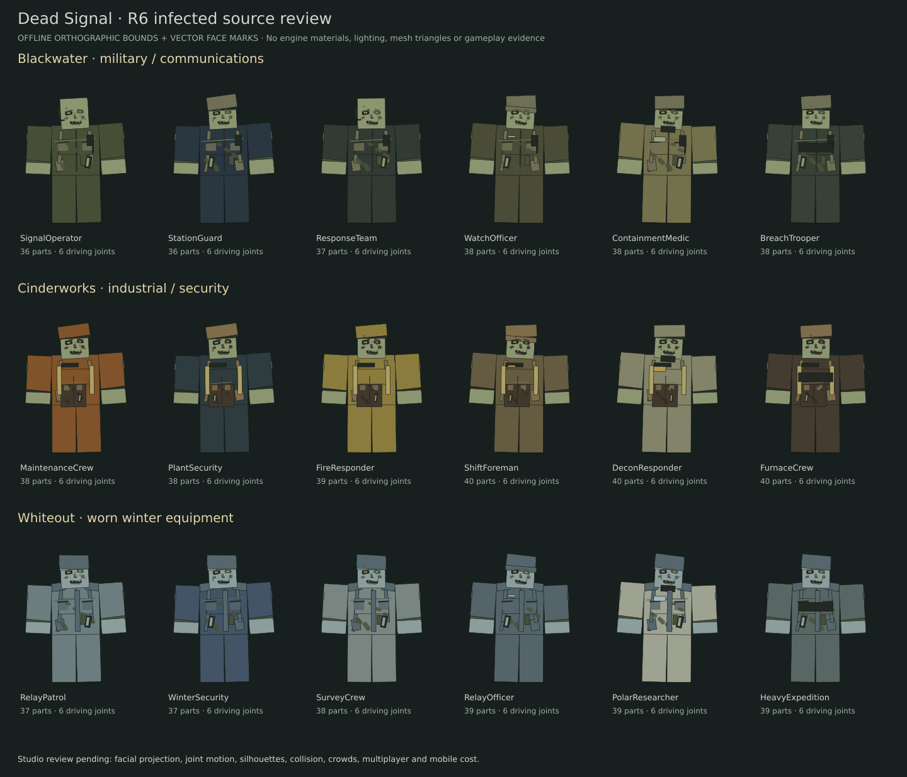
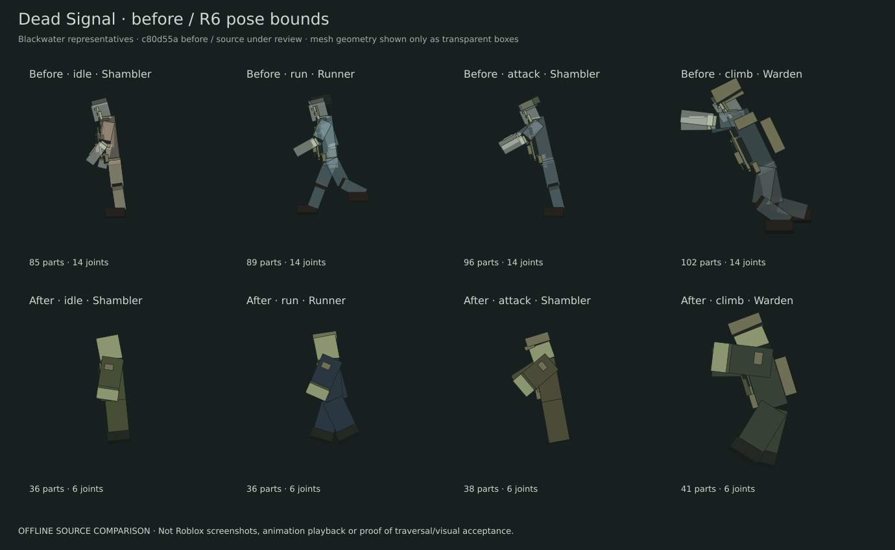

# Batch 1 enemy follow-up — DS-B1-002 / DS-B1-006

Source implemented; integration review and native gameplay retest pending. Neither bug is Verified. No publishing was performed or authorized by this PR.

- PR: [#53](https://github.com/stephennip9288-create/Roblox-Projects/pull/53), `fix/dead-signal-b1-r6-window-followup` -> `integration/dead-signal-batch1-1`.
- Audited integration base: `c80d55aeeae4b51ef8d836949a33bf440890c6b7`. Prior enemy #42, maps #39, adapters #41 and audio #43 were already merged; their work is retained.
- Window commit: [0282025](https://github.com/stephennip9288-create/Roblox-Projects/commit/0282025ddd6769bfd983413bb37d6f013043b7b5).
- Final runtime / R6 commit: [28dcb6c](https://github.com/stephennip9288-create/Roblox-Projects/commit/28dcb6c6f1259e2c2e873ffc2baf90b9fddc0be1). Subsequent review-only commits preserve these runtime bytes; see [Runtime.json](Runtime.json).
- Coordination: [MAIN/MAP thread #37](https://github.com/stephennip9288-create/Roblox-Projects/issues/37#issuecomment-6341350433). MAP dependency: [#52](https://github.com/stephennip9288-create/Roblox-Projects/pull/52), exact head `7bf748868a6963f84a52dc8931c866689ea9fa34`, Architecture blob `c5b5294dfd7f6f981ef73f17256868d9e5235652`.

## Window corrections

The exact c80 negative control admitted 90 actual Shambler rigs across 30 windows, with **45 admitted below the approach apron** onto lower ExteriorGround. Endpoint support alone allowed placements that did not have a same-level no-jump route to the entrance. This reproduces a concrete consumer defect; it is not a claim that every staging failure has been reproduced in Roblox physics.

`Navigation.queuePosition` now requires continuous physical floor support at approach level and a complete-rig static route before admission. Actual placement and traversal retain player/NPC occupancy checks. At all 30 windows the final R6 source admits at least one unit; 59/90 placements are safe, 31 are deferred, and zero low slots are admitted. Deferred units retain pending-admission/wave accounting. This intentionally admits fewer simultaneous exterior actors where geometry cannot support them.

Stale traversal reservations are released before the active-owner gate. Hard Geometry/Support exclusions expire after 30 seconds without repeated recovery calls extending their deadline; unchanged navigation revisions can therefore be reprobed after a transient obstruction clears. Existing different-window recovery, exterior-only visibility safeguards, quota/health preservation, animation cancellation, reverse traversal and timeouts remain. Successful entry always clears PlatformStand and restores chasing physics. Armor break invalidates cached whole-rig bounds so destroyed plates and exposed weak regions are reflected in subsequent sweeps.

MAP #52 independently fixes a missing actual landing strip at **Foundry_entry_10 / Crucible Lab**. Its flush support patch and this PR's reachable-queue admission address separate defects. The existing bounded seam fallback is retained. An isolated exact-source MAP+ENEMY overlay passes the final R6 matrix and MAP support suite; the MAP source is not duplicated in this enemy PR.

All routes still require animated exterior entry. No interior spawn or visible relocation shortcut was added, and no unit is killed, rewarded or removed from quota to hide a path failure. Persistent physical blocking of every eligible entrance can still defer admission; actual crowded queue drain and end-of-wave recovery require the native acceptance below.

## R6 correction

The owner's latest R6 instruction replaces the prior custom humanoid mesh direction for Batch 1. Humanoid `EnemyRigs.build` now uses six visible rigid body parts and six driving Motor6Ds, with no imported character MeshParts or texture/mesh asset IDs. The retained canine implementation still uses its existing art; HoundRig and RigAnatomy are unchanged.

Original SurfaceGui vector art supplies asymmetrical recessed eyes, clouded irises, damaged brows, hollow cheeks, crooked broken teeth, mottling and dry fissures. Skin is matte Sandstone; cloth, frayed cuffs, boots and equipment use Fabric/Leather/Rubber with zero reflectance. Six personnel families, three wear stages and four facial variants have deterministic variation. Blackwater uses communications/security gear, Cinderworks soot, aprons, hardhats and damaged workwear, and Whiteout worn parkas, knit caps and frost edges. Warden size/mantles, Stalker cowl, breakable armor, overgrowth and volatile canisters retain silhouette cues.

NPCPose adds asymmetric R6 shambling, running, rigid-arm attack, vault bracing, crawling and hit reaction poses. Existing attack clocks, damage authority, state cues and five-joint corpse conversion remain. The fourteen named server hit regions and zone tags are preserved through eight invisible rigid query proxies. **Their dimensions intentionally fit the new R6 anatomy**; this is not literal preservation of the old custom limb query geometry. The live BodyCollider and canonical agent/root clearances are unchanged. Exposed head/body weak regions remain outside the corresponding body query surface after armor breaks.

For 54 ordinary Shambler family/wear builds: 36–40 BaseParts, six motors, 39–41 GUI Frames, 138–148 descendant instances and zero MeshParts. Representative old Station idle build: 85 parts/14 motors; R6 idle: 36/six. Face/cloth rendering is occluded and limited to 70 studs. These are construction counts, **not device performance measurements**; SurfaceGui cost still needs mobile profiling. Elite counts are separately represented in existing combat/geometry suites.

No new creator mesh, texture upload or custom animation asset is required to load this R6 implementation. Its procedural art is ready for visual review, not certified as a completed quality overhaul. Native material appearance, rounded heads/helmets, face projection, joint playback and visual polish remain acceptance gates. Optional future authored textures are not a Batch 1 dependency. No placeholder projection is offered as native art evidence.

## Changed source and test scope

| Files | Change |
|---|---|
| server/Navigation.lua | Reachable queue slots, stale reservations, expiring exclusions, R6 whole-rig bounds |
| server/Enemies.lua | Recovery expiry preservation, reservation gate and post-entry physics |
| server/EnemyRigs.lua | Native R6 core/query proxies, weak-point fitting and entry-bound invalidation |
| server/InfectedWardrobe.lua | Original vector undead faces, themed matte clothing/gear and armor degradation |
| shared/NPCPose.lua | Six-joint humanoid movement/traversal/reactions; legacy/canine path retained |
| Tests/enemy-b1-entry-followup.luau | New actual-map admission and controlled lifecycle regressions |
| Tests/enemy-b1-r6.luau | New construction, hit authority, pose connection, weak point and death coverage |
| Tests/rigs.luau, infected-batch1.luau, enemy-b11-appearance.luau | Narrow migration from imported art/14 deform-motor expectations to R6; combat/collider/death checks retained |
| Tools/export-enemy-r6.luau, render-enemy-r6.py, review-enemy-r6-studio.lua | Offline comparison exporter/renderer and disposable Studio gallery |

The shared runner/loader, Config, Effects, Controller, NavigationGraph, Game, wave/director rules, HoundRig, RigAnatomy, native assets/baselines, place IDs, save schema, release controls and workflows are unchanged. There are still 61 runtime records. Batch 2 is excluded.

## Validation evidence

| Gate | Result |
|---|---|
| All 33 registered offline suites | **1,019,858 assertions, all pass** ([Tests.json](Tests.json)) |
| Runtime compilation | **61/61 pass** |
| New R6 suite, separately invoked | **15,359 pass** |
| New entry follow-up suite, separately invoked | **160 pass**, zero low slots ([after](Queues-after.json), [negative control](Queues-before.json)) |
| Existing strict all-map whole-rig window matrix | **210/210 pass**, all 30 windows/seven profiles |
| Exact MAP #52 + final R6 overlay | **210/210 pass**, source stable ([Combined-geometry.json](Combined-geometry.json)) |
| MAP support/mixed admission suite on overlay | **7,453 pass**, 6,990 physical part probes/zero misses, 59 admissions/61 safe deferrals ([Combined-map.json](Combined-map.json)) |
| Existing runtime + new entry suites on overlay | **1,069 + 160 pass** |
| Automatic CI on runtime commit | **All five no-publish families successful** ([CI.json](CI.json)) |
| Pipeline Python and lossless artifacts in CI | **81 cases pass; eight isolated environment builds; all four raw binary fidelity checks pass in each environment** |
| Native Studio/gameplay, multiplayer, phone profiling | **Not performed; required** |

The local Lune runs installed exact runtime source into retained full staging-audition artifact fixtures (artifact 12178125462), without editing them on disk. Automatic CI independently reran the same registered suite against the repository's original native Work v1.8 fixtures with the same 1,019,858 result. CI checked the PR merge ref `3d1f5419c4379bde8e4c8010d08d8ec1402ade0c` (28dcb6c onto c80d55a), not a published build. The no-publish production-readiness job built eight environment candidates and checked both; mock publisher unit-test log text is not evidence of a real release.

Source CI: [39781805449](https://github.com/stephennip9288-create/Roblox-Projects/actions/runs/39781805449). Lossless build/fidelity: [39781805305](https://github.com/stephennip9288-create/Roblox-Projects/actions/runs/39781805305). Eight-candidate environment parity: [39781805250](https://github.com/stephennip9288-create/Roblox-Projects/actions/runs/39781805250). Review-only staging artifact: [12426278864](https://github.com/stephennip9288-create/Roblox-Projects/actions/runs/39781805305/artifacts/12426278864), ZIP SHA-256 `f4c13ee85e93b82fe2b28a92ac6e98b401ccd908647fa20100b489f3e70948ed`, retention through November 5, 2026. This artifact contains ENEMY changes on c80; it does not include unmerged MAP #52 or AUDIO #54.

## Source comparisons

These are offline orthographic **part bounds and vector marks**, visually inspected after export. They do not show engine meshes, rounded surfaces, textures, lighting or animation playback. The prior custom meshes are transparent bounding proxies, so the comparison cannot establish superior native character quality. [Construction budgets](Budgets.json) record the measured counts.





## Reproduce offline

From `games/dead-signal/dev`, with Lune 0.11.0 and the full native fixtures installed as in CI:

```sh
python Tests/run.py --lune /path/to/lune --luau-compile /path/to/luau-compile
lune run Tests/enemy-b1-entry-followup.luau
lune run Tests/enemy-b1-r6.luau
lune run Tools/export-enemy-r6.luau 28dcb6c6f1259e2c2e873ffc2baf90b9fddc0be1
python Tools/render-enemy-r6.py
```

The Python renderer needs NumPy; Inkscape optionally adds PNG previews. SVGs are always written. To regenerate the before comparison/negative control, copy the five changed runtime modules **from c80d55a** to `Validation/EnemyB1Followup/BeforeSource/{server,shared}/`, preserving their group/name, then run the exporter or `lune run Tests/enemy-b1-entry-followup.luau before`. These frozen copies were blob-checked against c80. Do not change the source halfway through geometry runs.

To reproduce combined evidence, use a disposable checkout/copy of this enemy source and replace only Architecture.lua with MAP #52's exact blob above; add MAP's new test unchanged. Run `enemy-b11-geometry.luau <map-head> <enemy-source-sha>`, `map-window-geometry.luau`, `enemy-b11-runtime.luau` and the new entry suite. Keep that overlay out of the enemy commit.

## MAIN integration and native retest

1. Intake MAP #52 first, then ENEMY #53, and review AUDIO #54 independently. Rerun the full combined candidate after serial integration. Register `enemy-b1-entry-followup` and `enemy-b1-r6` plus MAP's `map-window-geometry` in MAIN's runner. The new enemy suites were invoked manually here; no shared registration was changed.
2. Reconcile MAIN's historical reviewed-runtime provenance ledger with reviewed integration source. MAP already reported its pre-existing Config #49 lock mismatch; this PR intentionally changes five further enemy/runtime blobs. This fresh Runtime.json supplies exact hashes; it does not rewrite a prior frozen review or waive release gates.
3. Open a disposable full candidate in Studio. Optionally paste `Tools/review-enemy-r6-studio.lua` into the **server Command Bar** for a removable native face/material/pose gallery. It requires installed R6 source, guards IsStudio, and creates only Workspace.DeadSignalR6Review. Delete that folder to remove it. The gallery has no gameplay AI/collision and is not a traversal test. No Studio screenshot or gallery execution is claimed in this handoff.
4. In actual gameplay record the build SHA, map/window id, device, crew, mode and round. Repeat all 30 windows with seven existing profiles, first isolated, then groups of 10 and 30 converging actors; repeat each case. Watch approach/contact/vault/crawl/landing and subsequent player chase. Include the Crucible Lab landing and all approach apron lips. Verify pending units drain as space clears, no embedded feet/gear, no hovering, no visible relocation, and each cue fires once.
5. Block/unblock openings during each traversal stage, break armor during entry, stun/kill actors, delete a root, destroy the reserved actor, switch/down/disconnect targets and remove blockers after 30-second exclusion expiry. Observe bounded cancellation/reverse/retry and other-window recovery. Check root anchoring/PlatformStand/AutoRotate and NavigationState/TraversalStage. Track remaining live + pending quota and make a last-wave unit recover without a silent retirement or duplicated spawn.
6. Inspect the real R6 faces at firing distance and close-up, matte skin, torn uniform/readable map roles, exposed weak points, armored/enraged/volatile silhouettes, Warden and Stalker. Record shambling, sprinting, attacking, vaulting, crawling, flinch and corpse clips. Compare to the previously deployed native characters using actual screenshots/clips; offline boxes do not satisfy this gate.
7. Repeat solo/2/4-player on desktop and mobile, including low effects and large waves; measure client/server frame time, network and SurfaceGui cost. Retest damage/headshots/armor/reactors/death, hound packs/Alpha, scaling/special waves, Warden, revive and extraction. Existing offline coverage passes; native compatibility is still pending.

Only the integration lead may designate a combined candidate Ready for Retest after review. Verified requires actual gameplay evidence. Staging and production publication each still require explicit owner approval. Rollback is a reviewed source revert of the two enemy runtime commits, preserving MAP/AUDIO intake separately, followed by rebuilding/retesting; this PR performs no deployment or rollback.
