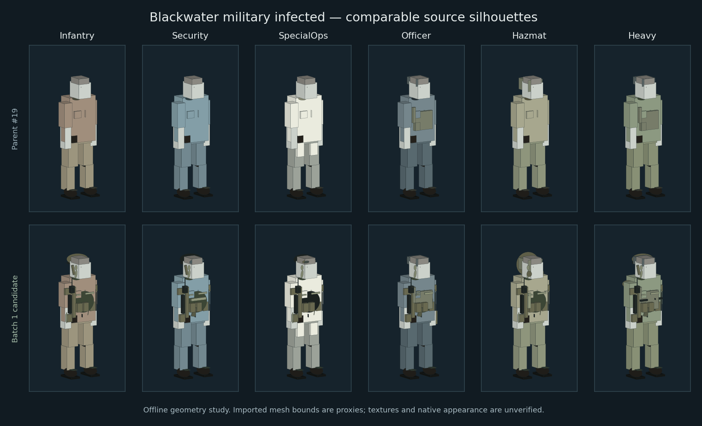
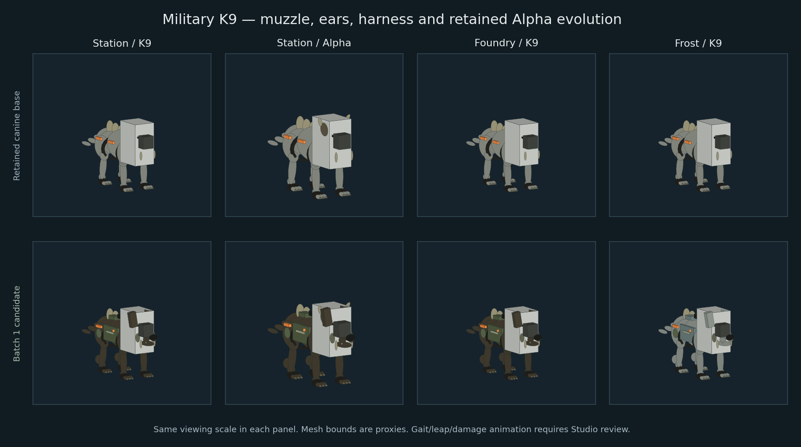
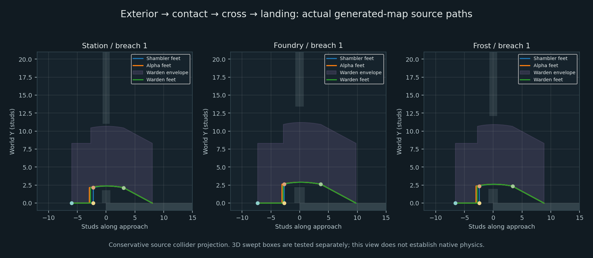
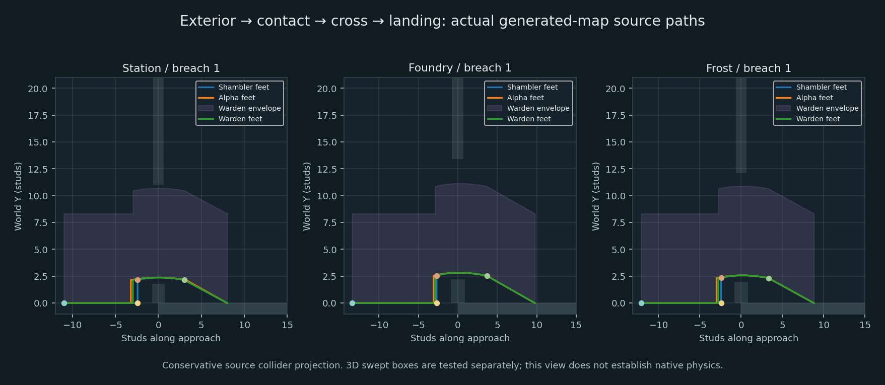

# Enemy Batch 1 — source candidate and integration handoff

Branch: `feature/dead-signal-infected-batch1`. Started at parent #19,
`7d5f23f48eb61fb57a0f785378b22010594237c9`. Parent #19 is merged. The
candidate uses combined integration `2b7073cda226882343b925569bcc2b51fa7dfd88`,
including #18/#21/#19/#20/#25, as its commit parent and verification base.
No parent feature branch is rewritten. The current native delivery inventory
remains 61 runtime scripts. Nothing is published or merged by this handoff.

## Gap audit and implementation

The parent already supplies articulated query-tagged skeletons, fitted native
head/jacket meshes, PBR variants, normal gait, Alpha spines/antlers, elite armor,
Stalkers, special waves, hazards and bounded navigation recovery. Its old
InfectedWardrobe module was unused; the live rig builder used Anatomy directly.
Window entry moved directly to an interior slot, and Warden phase runners were
created beside the boss. Those are the main functional gaps addressed here.

| ID | Source improvement and evidence | Acceptance/dependency |
| --- | --- | --- |
| EN-01 | Jaw/temple/tendon and asymmetric infection details; retained imported meshes/materials; tests compare every authoritative hitbox's dimensions, rest frame, query flag and zone across six species/three sites. | Native textured appearance and visible-pose/server-hit agreement remain unverified. Procedural additions do not establish realistic asset quality. |
| EN-02 | Six deterministic uniform families, three wear stages, radios/webbing/pouches/filters/torn sleeves; details are massless, non-queryable and non-colliding. | Studio art review at gameplay distances. |
| EN-03 | Canine muzzle/nose/sternum/hocks, articulated jaw/ears, contact/leap/landing poses and directional damage responses. Existing four-legged gait and attack/pack rules are retained. | Native gait, foot contact and damage animation need review; no new high-fidelity animal mesh was imported. |
| EN-04 | Server-driven approach → contact → cross → descent → settle → pursuit, continuously swept against geometry/occupants; collision/locomotion restored only after landing. | Multiplayer interpolation, native collision and hit alignment require Studio. |
| EN-05 | Infantry, Security, SpecialOps, Officer, Hazmat and Heavy families, with Blackwater comms, Cinderworks containment and Whiteout expedition details. | Readability and imported-clothing fit/texture quality remain art acceptance items. Heavy uniform gear does not grant new armor. |
| EN-06 | K9 harness/handle/unit markers, coat variation and injuries. Existing Alpha scale/antlers/spines remain distinct; neither hitboxes nor modifiers are replaced. | Real-client K9/Alpha silhouette and motion acceptance. |
| EN-07 | Optional geometry-authored Door/Tunnel/Vent/LowVault/Ledge consumer; room/door/species/clearance checks, swept movement, retreat, cooldown and two-use link budget per nav revision. | Dormant until Maps/MAIN DEV review and author contextual links. Existing native no-jump/no-climb pursuit remains active. No map coordinates were edited. |
| EN-08 | Directional additive visual flinch (0.18 s throttle), lethal impulse direction and cosmetic equipment loss on confirmed armor break. Damage, precision stun, rewards, weakpoints and attack timing remain authoritative. | Native ragdoll/shot-to-pose agreement and replication review. Visual cooldown never suppresses damage or adds stun. |
| EN-09 | Exterior queue and visible entry; Warden escorts use an exterior breach. Missing canonical descriptors use the checked legacy window path. Existing spawn-distance scoring remains in force. | New vents/tunnels/exterior footing require reviewed map anchors; semantic Audio hookup is pending. No instant room spawn or bespoke audio is claimed. |

## Source visual evidence

These are reproducible **offline geometry projections**, not Studio screenshots.
Imported MeshParts are bounding proxies, without their triangles or textures.
They help compare equipment placement, scale and traversal envelopes. They do
not establish realism, asset rights, native lighting or visual acceptance.







The K9 baseline includes the parent's existing Alpha evolution, so its retained
size/antlers/spines are not credited as new Batch 1 work.

## Maps and traversal contract

The implementation consumes the integration lead's canonical optional
`window.entry`: schema 1, stable ID, `kind="Window"`, matching room, world-space
approach/breach/landing CFrames facing -Z along travel, physical
`clearance={radius,height}`, and optional **list** `allowedKinds`. Dimensions are
checked against the actual evolved agent, including Alpha/Ironbound/Warden.
Malformed/backwards/unsupported descriptors fail closed. No alternate
`window.traversal` schema is used.

The consumer accepts two bounded interpretations against the actual supported
landing floor: explicit foot/contact CFrames, or Maps #29's existing navigation
reference (approach/landing 3.5*scale above floor, breach at opening center).
For the latter it subtracts the physical reference height and half the declared
opening height to derive feet/sill coordinates. Other heights fail closed; an
unsupported upper landing cannot project onto the ground. Queue spawning and
traversal use the same normalized feet. The producer's coordinates are never
scaled twice. Exterior terrain/footing still needs native Maps acceptance.

| Source geometry | Usable / tested | Safely rejected |
| --- | --- | --- |
| Integrated parent maps at 2b7073c | 209 / 210 | Blackwater window 6 Warden, Maintenance UpperGalleryDeck. |
| Maps #29 at 069d247 | 207 / 210 | Blackwater windows 6/7 Warden beneath Maintenance UpperGalleryDeck, and window 8 beneath Control Room UpperGalleryDeck. |

Every agent profile has an initial-sector entry. On Maps #29, the two sectors
without a direct Warden entrance have purchased-door graph recovery routes from
an eligible entry. This checks source graph hints, not a native navmesh. Smaller
profiles fit every new map window. Collision is never bypassed for an oversized
agent. After bounded outside failure, recovery suppresses the window for the
species for eight seconds and carries failed windows through a bounded recovery
cycle (maximum ten keys). It tries alternatives before repeating; a navigation
revision or exhausted cycle allows fresh attempts. Warden HP/phase/cooldowns are
preserved; ordinary agents keep the parent's three-recovery retirement policy.

Maps/MAIN DEV should review the three Warden eligibility/clearance exclusions
before final acceptance; the descriptors currently include Warden. No map source
is changed in this branch. Exact seven-map-module hashes and the cross-branch
**19,405-assertion** audit are recorded in Verification-Report.json.



The optional **contextual-link proposal** is separate from canonical window
spawning. No current map supplies these links. `map.traversals` entries use:
`id`, `kind` (Door/LowVault/Ledge/Tunnel/Vent), world-space feet vectors
`approach/contact?/landing`, optional `room`, current built `door` object,
physical `width/height/rise`, and an optional species dictionary `kinds`.
This is an enemy-side prototype for review, not a frozen shared schema. Do not
author or enable vent/tunnel spawns until the integrator approves the geometry
and kind-specific traversal. Locked sectors/closed doors remain blocked.

Mutable window lifecycle fields belong to Enemies: `activeEntry`, `nextEntry`
and `entryBlockedUntil[kind]` (finite retry timestamp). Existing boards/count,
inside/outside, room and part fields remain intact. No persistent data changes.

## Audio/Combat integration

Actual traversal transitions publish replicated NPC attributes:

| Attribute | Meaning |
| --- | --- |
| EntrySourceId | `enemy:<run id>:<enemy id>:<attempt>`; new token for each traversal. |
| EntryCue / EntryCueAt | Canonical `Enemy.Entry.Approach`, `.Contact`, `.Land`, or `.Cancel`, with server time. Each emits once per attempt; Land occurs after descent at the supported landing. Cancel is immediate on retreat/reset/death/target loss. |
| TraversalStage/Style/StageAt/StageDuration/Held/HoldPhase | Existing NPC pose input, including safe animation holds. |

The current client receives only the unchanged `Board {position}` stock contact
and landing fallback (global maximum four per second). No new remote fields are
introduced. Approach semantics and cancellation are ready for a client adapter;
they are **not automatically audible**. MAIN DEV/Combat UI owns the Controller
adapter to Audio #26: translate one source lifecycle into the approved sound
context, cancel on `.Cancel` or model removal, and suppress the matching stock
fallback when the semantic path is active. Do not play both. Existing warning
feeds/durations remain unchanged; none are duplicated here.

HitVector/HitAt/HitStrength/HitHead and optional DeathVector are presentation
facts on the NPC. Confirmed server damage/armor break drives them; no Combat,
Controller, Effects, Config or new damage remote is changed by this lane.

## Tests and budgets

See [Verification-Report.json](Verification-Report.json) for source blob hashes,
per-suite counts and results. Lune service doubles establish state/lifecycle
logic; the geometry audit uses actual generated colliders with continuous
AABB/OBB sweeps, conservative wedge boxes and source floor polygons. It does
not run Roblox Terrain, navmesh, physical contacts or networking.

- Standard combined integration: 20 suites, **580,333 assertions**, all pass.
- Enemy follow-up: 3 suites, **23,020 assertions**, all pass.
- All **61 runtime scripts compile**; **59 Python pipeline tests pass**.
- Source geometry: **19,587 assertions**, 209 usable combinations, one safely
  rejected Warden route; the Maps #29 compatibility run adds 19,405 assertions.
  Total across the two geometry contexts and core regressions: **622,758**.
  Downed bodies, blocked/static/occupied landing, target
  loss, repaired barriers, cancellation, death/Volatile cleanup and source cue
  lifetime are covered by the other follow-up suites.

`Tests/run.py` remains integrator-owned. Standard CI executes the 20 registered
suites; it does **not** execute the three new suites until MAIN DEV registers
them. The independent verifier is committed and was executed locally:

```sh
python Tests/run.py --lune /absolute/path/to/lune --luau-compile /absolute/path/to/luau-compile
python Tests/run-infected.py --lune /absolute/path/to/lune
python Tools/render-infected.py
```

Run from `games/dead-signal/dev` after the existing known-good temporary staging
fixture setup in Tests/README.md. The renderer additionally needs NumPy and
Matplotlib. Generated JSON/SVG/PNG files go under Validation/ and Reviews/;
temporary native fixtures are read-only inputs, never serialized back.

Limits: four simultaneous traversals, one active shared clock at up to 30 Hz,
one entrance planning attempt per AI tick, 0.8 s per-agent planning interval,
bounded displacement per step, bounded retreat/timeout/retries. New decorative
parts are capped at 66 per humanoid and 34 per K9; only three new cosmetic K9
motors. Existing 12 path requests/s, three concurrent paths, 40 NPCs, eight
hazards and corpse limits are retained. These are code bounds, not measured
Roblox performance results.

## Remaining native acceptance and assets

No new mesh, texture, audio ID or Roblox upload was added. Existing fitted native
meshes/SurfaceAppearance and DS_Canvas/DS_Leather/DS_InfectedSkin/DS_Canine are
retained inputs. Offline deserialization does not certify experience permissions
or licenses. New anatomy/uniform/K9 details are original primitive geometry;
higher-fidelity skin/uniform/canine assets need a separately approved asset path.
Board sound remains the documented existing stock placeholder. Bespoke
approach/gear/K9 recordings belong to Audio and remain unavailable here.

Required Studio/private-client checks, with separate owner approval before any
publish: all three maps with solo/2-/4-player crews; close-range shots against
visible head/limbs during contact/cross and hit reactions; repaired/blocked
windows, downed/revive occupancy, body piles and Volatile deaths; Warden and
extraction phase transitions; high-round 40-NPC packs with four concurrent
entries, server/network profiling and Low Effects/mobile readability; native
foot contact, interpolation, ragdoll recovery and imported art/material quality;
newly authored contextual links and upper landings; Audio lifecycle/listening
and asset permissions. Physical phone comparison remains pending.

Dispatch/loading artwork, saved profiles, economy, place IDs, deployment files,
native baselines and staging/production/rollback binaries are unchanged. Existing
offline arrival/extraction/loading regressions pass; actual travel/rejoin and
persistence still require the integrated native playtest.

Rollback is a scoped revert of this follow-up's commits and the existing lossless
rebuild. Preserve parent #19 and other lanes. No migration, native rollback edit,
staging/production dispatch or direct main merge is part of this work.
