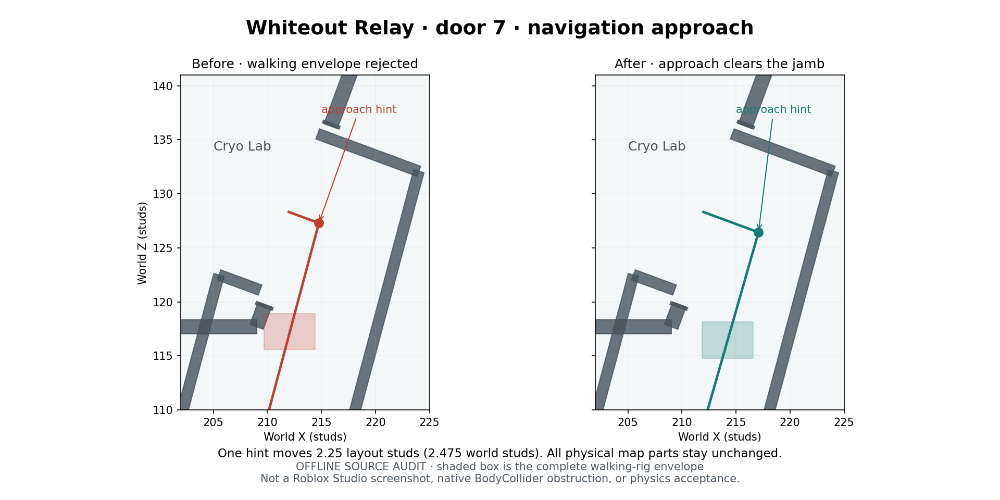

# Batch 2 B2-03 — MAP navigation support

Whiteout Relay door 7 has a nearly tangential Cryo Lab approach that the accepted complete walking-rig clearance validator rejects against the wall/jamb. This patch moves one navigation hint within the existing corridor. It changes no physical geometry. Blackwater Station and Cinderworks have no reproduced map defect requiring an edit in this audit.

Implementation is ready for MAIN's source review. **Integration remains blocked** by reviewed Batch 2 provenance intake, registration of the new suite, and combined ENEMY validation. This is offline evidence; no bug is marked Verified and no native gameplay acceptance is claimed.

## Source and ownership

- Approved tracker: [#62](https://github.com/stephennip9288-create/Roblox-Projects/issues/62).
- Base: `7aaf323de6153134df2154c7ae3b1613a596495b` (accepted Batch 1 main).
- Tested source: [82aa087f41683e3d96511da75192fc5433f5851a](https://github.com/stephennip9288-create/Roblox-Projects/commit/82aa087f41683e3d96511da75192fc5433f5851a). The subsequent review commit adds tools/evidence only.
- Branch: `feature/dead-signal-b2-map-navigation`.
- Open draft: [#69](https://github.com/stephennip9288-create/Roblox-Projects/pull/69), targeting `integration/dead-signal-batch2`. MAIN owns integration; this specialist does not merge.
- Runtime owner edit: `Source/Runtime/server/Architecture.lua` only. No shared Navigation, NavigationGraph, Game, runner, historical ledger or workflow edit.
- [Runtime.json](Runtime.json) lists all 61 baseline/candidate runtime blob IDs for MAIN's review. It is proposed delta evidence, not an approved provenance ledger. Architecture changes from `c5b5294dfd7f6f981ef73f17256868d9e5235652` to `7ad97ec938268a0dffa4f9cb8d81da491e44ab03`; the other 60 blobs match.

## Reproduction and focused correction

On Frost, door 7 joins room 3 (Reactor) to room 6 (Cryo Lab). The baseline third waypoint approaches almost parallel to the angled wall. Sweeping the complete retained walking-rig envelope rejects 169 samples across the seven enemy profiles and both directions; all rejections are at this passage. The exact approach anchor also misses the strict source support ray. The actual native BodyCollider is clear in the separate diagnostic probes: this establishes a route-hint/full-envelope clearance defect, not an impassable physical doorway or a verified native zombie failure.

The third waypoint is offset outward along the existing entrance normal by **2.25 layout studs / 2.475 world studs**. It remains in the authored supported corridor. Derived graph node `door7p3.position` follows that waypoint automatically. The four waypoint IDs/order, portal room assignment, door price, room graph edges and every other waypoint remain unchanged. Corridor construction retains its original local path, so the floor, walls, gate and player passage are identical.

| Coordinate | Before | After |
| --- | --- | --- |
| X | 214.76217651367188 | 217.08396911621094 |
| Y | 0 | 0 |
| Z | 127.29830932617188 | 126.44103240966797 |

Offsets 0, 0.5, 1, 1.5, 2, 2.5, 3, 3.5, 4, 5 and 6 layout studs were probed before choosing the midpoint of the passing 2–2.5 interval. Smaller/larger offsets encounter the surrounding clearance constraints. The final 2.25 choice passes continuous sweeps, turn envelopes and exact support.



This is a plot of captured source-built transforms and the full walking-rig envelope, not a Studio screenshot. The two panels have identical physical walls. Native before/after clips remain an integration verification task.

## Per-map inventory

| Map / internal ID | Result | Preserved BaseParts | Full-rig sweeps | Graph cases |
| --- | --- | ---: | ---: | ---: |
| Blackwater Station / Station | No reproduced producer defect; no runtime change | 5,771 | 17,920 | 15,360 |
| Cinderworks / Foundry | No reproduced producer defect; no runtime change | 6,187 | 23,240 | 15,360 |
| Whiteout Relay / Frost | Door 7 third waypoint and derived node position corrected | 6,415 | 31,290 | 15,360 |

All 27 door passages retain their dimensions: Station 14×14, Foundry 17.08×17.08, Frost 15.4×15.4 world studs. Actual Game purchase callbacks clear gate and descendant collision/query and increment navigation revision. Closed gates block the crossing. All 512 gate masks per map agree with explicit room connectivity for every directed room pair. The test distinguishes topological connectivity from native path selection inside a room.

[Preservation.json](Preservation.json) compares produced snapshots: **all 18,373 BaseParts match** in captured transforms, dimensions, collision/query/touch, material/color, transparency, shadow, anchor and collision group. Mesh/texture properties are compared where Lune exposes them; unavailable properties are marked, not inferred. Only the two Frost metadata fields listed above differ. Window schema/approach/breach/landing transforms, mounts, stairs and graph edges match. All 177 protected inputs inventoried under workflows, scripts, baselines, places, work-source and releases are unchanged.

## Test results

| Check | Result |
| --- | --- |
| New `Tests/map-b2-navigation.luau` | **119,393 checks pass**, including 72,450 full-rig sweeps and 46,080 graph cases; zero rejection/topology failures |
| Exact-baseline negative control | 119,323 checks; reproduces 169 rejected sweeps at Frost 7 plus one exact-anchor support failure |
| Supplementary turns | **18,900 pass**: seven profiles, 27 passages, both directions, two corners and 25 yaw samples |
| Existing registered Lune suites | **39 suites / 1,071,963 assertions pass**, including accepted windows, ramps, player collision, purchases and enemy runtime regressions |
| Luau syntax via Lune compiler | **122 files compile**, including all 61 runtime records |
| Root Python | **98 pass** |
| Dev Python | **24 pass, 2 fail, 2 skip**; failures and exact hashes are recorded below |
| Projected ground routes | All 30 tested purchase states pass; no projected corridor obstruction |
| Elevated route audit | **6,953 swept samples pass**, zero obstruction (Station 2,027 / Foundry 2,712 / Frost 2,214) |
| Four complete native staging artifacts | **4 source-only builds and independent fidelity audits pass**; no publication |

Walking sweeps sample all three legs of each authored four-point passage at at most 0.5 world-stud spacing, in both directions. Profiles are Shambler, Armored+Enraged Runner, Crawler, Hound, Alpha Hound, Stalker and Warden. Tests construct the actual rigs and use their complete retained Walk/Approach envelope with the existing Navigation validator and convex map collision double. Tests do not represent Roblox physics, navmesh generation, real Humanoid locomotion or crowd scheduling.

Strict source floor rays also report **144 other diagnostic cases** (Station 16 / Foundry 93 / Frost 35). Every case finds real same-height neighboring support after a 0.001 world-stud shift. No broad support gap is reproduced. [Support-Diagnostics.json](Support-Diagnostics.json) keeps the exact locations and support parts. These are precision/seam diagnostics requiring native comparison; neither floors nor consumer tolerances are changed to hide them.

Detailed results: [After-Report.json](After-Report.json), [Before-Report.json](Before-Report.json), [Turns.json](Turns.json), [Tests.json](Tests.json), [Syntax.json](Syntax.json). The additional turn/support tools are standalone diagnostics, not replacements for the registered suite.

### CI gate requiring MAIN

Both dev Python failures call the frozen Batch 1 `assert_reviewed_runtime` guard and reject the intentional Architecture blob delta:

- `test_audio_corrections_b1.AudioCorrections.test_only_owned_audio_bytes_change`
- `test_audio_quality_b11.AudioQualityB11.test_all_runtime_records_match_reviewed_integration`

The two skips require external source PCM/prepared-WAV fixtures. Neither failure is waived. Historical ledgers, provenance tests and release controls are preserved.

[CI.json](CI.json) records the source commit's five completed GitHub runs and inspected failing job logs. Validate Roblox Cloud Project passes; source CI, lossless CI, private preflight and production-readiness checks stop at the same two provenance assertions. They do not reach their later runtime/build stages; the local gameplay and complete-place build evidence above is separate.

MAIN must review a Batch 2 development/intake provenance path with explicit lane deltas while preserving frozen Batch 1 records. AUDIO #70's narrower audio adapter does not approve this Architecture change. MAIN/ENEMY must also register `map-b2-navigation` in `Tests/run.py`, additively with the ENEMY and other lane suites. Shared runner changes are deliberately left to their owner.

### Native asset fidelity

[Builds.json](Builds.json) pins candidate byte counts/hashes for Dispatch, Blackwater, Cinderworks and Whiteout. All 61 expected source records are patched into each retained complete native baseline. All non-source raw chunks are byte-identical; independent property fidelity passes. Untouched chunk counts: Dispatch 1,513 / Blackwater 1,496 / Cinderworks 1,500 / Whiteout 1,500. These are local staging-configured artifacts, not deployed places. Native inputs and production configuration remain unchanged.

## ENEMY / MAIN handoff and native verification

ENEMY [#71](https://github.com/stephennip9288-create/Roblox-Projects/pull/71) checkpoint `90b644e8d2925f8866901497b4d3bce20b8bf896` still builds portal nodes from `d.waypoints`; no interface/schema change is required by this patch. ENEMY owns final planner validation, room/stair intent, segment validation, access invalidation and congestion behavior. Combined code has not been certified by this specialist audit. MAIN should consume the exact waypoint and preserve all existing metadata contracts.

Before native acceptance, MAIN and ENEMY should record:

1. Native navmesh/Humanoid pursuit through Frost door 7 in both directions for all seven profiles, including stop/turn/reverse and supported approach height. Compare full-rig validation to the actual BodyCollider outcome and the 0.001-stud seam diagnostics.
2. All 27 passages and raised-room/stair connections on every map with gates locked/unlocked/purchased during pursuit. Check wall-side selection, blocked/stale routes, recovery/reacquisition and no access to locked or unreachable spaces.
3. Multiple enemies at narrow passages and 40-enemy mixed-profile pursuit; demonstrate doorway queuing/landing release without deadlock, wall grinding or extra path-computation spikes. A static turn envelope is not a crowd test.
4. First-person desktop and Android/iOS input, solo/two/four clients: player traversal, accepted window entries, door reachability/signage, cover routes, downed/revive, Warden, extraction and Dispatch travel. No desktop, physical phone or multiplayer session was run here.
5. Studio screenshots/clips and combined frame/pathfinding budgets. Final staging acceptance remains owner-controlled; do not mark Verified from offline results.

No staging/production publish, specialist merge, native asset edit, Batch 3 work or new map remaster is performed.

## Reproduction

Use Lune 0.11.0 and the repository's complete native fixtures; prepare `dev/Places/DeadSignal-v1.8.0-{Lobby,Station,Foundry,Frost}.rbxl` from the retained staging fixtures as described by existing development setup. Run from `games/dead-signal/dev` unless specified:

```bash
mkdir -p Validation/B2MapNavigation
git show 7aaf323de6153134df2154c7ae3b1613a596495b:games/dead-signal/dev/Source/Runtime/server/Architecture.lua > Validation/B2MapNavigation/BeforeArchitecture.lua
lune run Tests/map-b2-navigation.luau before Validation/B2MapNavigation/BeforeArchitecture.lua
lune run Tests/map-b2-navigation.luau
lune run Tools/map-b2-support-diagnostics.luau
lune run Tools/map-b2-turn-audit.luau
python Tests/run.py --lune /absolute/path/to/lune
python Tests/check_map_remaster.py
python Tests/check_map_batch1.py
python -m unittest discover -s Tests
```

The first command in the new regression deliberately expects baseline failures; candidate mode must have none. Negative and positive reports and snapshots are written under ignored `Validation/B2MapNavigation`. The baseline negative check uses only the old Architecture source, not an unreviewed native replacement. Run root Python and offline builds from repository root:

```bash
python -m unittest discover -s tests
python scripts/patch_dead_signal_rbxl.py --environment staging
python scripts/audit_dead_signal_binary.py --candidate-dir build/dead-signal-lossless/staging --baseline-dir games/dead-signal/full-baselines/v1.8.0
```

`Tools/review-b2-map-navigation.py` rebuilds the preservation/build/test summaries and plot from these captures and `Validation/B2MapNavigation/Syntax.json` (all Runtime/Tests/Tools Lua/Luau files compiled via `@lune/luau.compile`). Matplotlib/NumPy are authoring-only dependencies. Its source SHA and counts deliberately pin this specialist checkpoint; rerun combined intake with a newly reviewed manifest rather than rewriting this evidence as historical acceptance.

Rollback is the Architecture hunk only (revert the tested source commit before integration); native assets do not require restoration. Removing the metadata correction restores the reproduced negative control. MAIN should retain this report when reviewing or reverting the patch.
