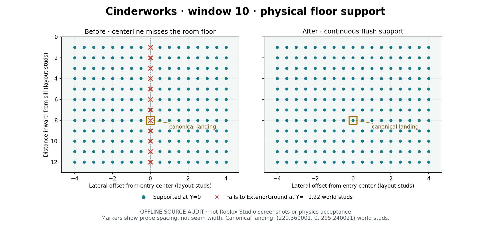

# DS-B1-002 — Batch 1 window geometry follow-up

Cinderworks `Foundry_entry_10`, in Crucible Lab, lies on a paired room-floor wedge seam. An actual-part center ray misses that floor and falls 1.22 world studs to `ExteriorGround`. The integrated Navigation consumer compensates by shifting its landing target 0.05 world studs. This patch adds **one flush floor strip** from the sill through the landing so the canonical target has direct physical support.

[PR #52](https://github.com/stephennip9288-create/Roblox-Projects/pull/52) targets `integration/dead-signal-batch1-1`. Base: `c80d55aeeae4b51ef8d836949a33bf440890c6b7`. Tested runtime: [f63b0150f9a794fd20f98768a8237e44a38d068f](https://github.com/stephennip9288-create/Roblox-Projects/commit/f63b0150f9a794fd20f98768a8237e44a38d068f). Subsequent review commits preserve all 61 runtime blobs. Merged Maps #39 and Enemies #42 are retained. Comparing the published four-fix source `c466248b` to this base shows only later audio-intake/config/test changes, with identical map geometry. No Batch 2 work.

## Per-map inventory

| Map | Geometry correction | Actual support probes | Before → after misses | Existing parts retained |
| --- | --- | ---: | ---: | ---: |
| Blackwater Station | Audit only | 2,330 | 0 → 0 | 5,771 |
| Cinderworks | One `EntryLandingFloor` at `Foundry_entry_10` | 2,330 | 16 → 0 | 6,186 |
| Whiteout Relay | Audit only | 2,330 | 0 → 0 | 6,415 |

The new slab is 11 × 1 × 14.0625 layout studs, top Y=0, with a 1/32-layout-stud overlap at the existing apron. It is anchored/queryable/collidable, has no touch events, and is registered in `map.floorParts`. It is transparent and casts no shadow so the existing visible floor is preserved without coplanar flicker. Its interior corners stay in the existing room polygon. Cinderworks gains one static part (6,187 total), with no new lights. Opening/sill/header dimensions, canonical frames, legacy hints, kinds and eligibility are unchanged.

[Preservation.json](Preservation.json) compares all 18,372 pre-existing BaseParts across their captured transform/render/collision properties and all entry, door, mount, navigation-node, stair, playable-area and dressing records: zero changes. All 148 protected inputs are byte-identical. Only `Architecture.lua` changes among the 555 existing repository blobs; no native assets, manifests, release controls, shared runtime or ENEMY files change.

## Offline verification

- New `Tests/map-window-geometry.luau`: **7,516 checks pass**. Includes 6,990 actual-part floor probes, all 30 anchor/frame/opening checks, and four mixed full-rig queue admission attempts per opening. Current integrated consumer admits 120 statically supported/non-overlapping placements. This does **not** establish their route to the raised apron.
- Negative capture on the exact base Architecture: 16 support misses and one compensated-target discrepancy, exclusively Foundry10. Twelve misses run along the centerline at inward distances 1–12 layout studs; the other misses cover the canonical target and its precision neighborhood. After repair the raw and consumer-resolved landing both remain `(229.360001, 0, 295.240021)` world studs.
- All **33 registered suites pass / 1,026,501 assertions**, including 210/210 actual-rig window/profile plans, 63 contextual traversal profiles, existing admission/quota, crowd, blocker, recovery, cancellation, combat, audio and progression tests. Adding the new map suite gives **1,034,017 assertions**. MAIN still owns registering that new suite.
- 81 pipeline Python cases and six audio patch guards pass. All 111 Luau files compile, including exactly 61 runtime records. All 30 offline purchase states and 6,953 elevated body-clearance samples pass; the prior 12 stair/landing fixes remain intact.
- Four staging and four production-preview builds pass lossless raw-chunk preservation and independent property-signature fidelity. Exact candidate hashes/byte counts are in [Builds.json](Builds.json). These are offline artifacts, not published places.
- The supplemental historical audio provenance test has **one disclosed failure**: its reviewed-runtime ledger still expects pre-#49 Config, and this patch intentionally changes Architecture. Seven other available audio inventory tests pass; one prepared-PCM test is skipped without WAV inputs. MAIN must reconcile its review ledger and fixed PR/head expectations at intake. Audio tests/old review locks are not rewritten by this map lane. Normal registered audio Luau suites pass.

[Before-Report.json](Before-Report.json) · [After-Report.json](After-Report.json) · [Tests.json](Tests.json) · [Runtime.json](Runtime.json)



The image is an actual source-ray audit plot. Probe markers do not depict seam width. Native before/after screenshots were unavailable.

## ENEMY / MAIN integration

[ENEMY PR #53](https://github.com/stephennip9288-create/Roblox-Projects/pull/53) separately fixes lower-ground queue admissions without a reachable no-jump route, stale reservations, transient failure exclusion and chasing state. A temporary read-only overlay of its initial checkpoint `0282025ddd6769bfd983413bb37d6f013043b7b5` with this map patch passes **7,453 support/queue checks**. Its same-level route policy safely admits 59 of 120 mixed attempts and defers 61; all windows retain a supported lead admission. See [Consumer-Preview.json](Consumer-Preview.json). The original 120-placement result must not be interpreted as 120 reachable admissions. Deferred slots remain ENEMY pending tickets; no exterior floor expansion is required to force admission.

MAIN should review Maps #52 before the final ENEMY intake, register `map-window-geometry`, reconcile the historical provenance ledger and rerun the full suite on the final combined SHA. The current preview covers #53's **initial consumer checkpoint**, not its forthcoming R6 geometry. ENEMY owns bounded queue retry/drain, live occupancy, recovery and quota preservation. Keep the bounded seam fallback elsewhere; this patch supplies no evidence for removing it. Coordination and exact snapshots are recorded on [#37](https://github.com/stephennip9288-create/Roblox-Projects/issues/37#issuecomment-6335898044).

## Native acceptance still required

No Roblox Studio, physical desktop/mobile, multiplayer, navmesh or live pathfinding test was performed here. Offline SAT sweeps and exact-part support rays do not model engine contact tolerances or crowd motion.

Retest all 30 openings, especially Foundry10, after integrating the **final** ENEMY rig/consumer source. Use first-person desktop and mobile, solo/2/4-player sessions, mixed crawlers/Alpha hounds/Warden, simultaneous arrivals and high-round density. Record build/map/window/device/crew and verify approach, contact, climb, landing, chase, blocked/reversed entry, cleared landing, pending admission/retry, wave accounting and reservation release. Confirm no player ledge/exterior access, door/purchase interference or collision snag. Capture actual before/after and crowded-entry clips. Preserve the earlier all-stairs/downed/revive/extraction checks.

DS-B1-002 remains unverified. No bug is marked Verified, and no Roblox upload or staging/production publication occurred.

## Reproduce

With the repository's usual temporary native fixtures and Lune 0.11.0, run from `games/dead-signal/dev`:

```sh
mkdir -p Validation/MapWindowGeometry
git show c80d55aeeae4b51ef8d836949a33bf440890c6b7:games/dead-signal/dev/Source/Runtime/server/Architecture.lua > Validation/MapWindowGeometry/BeforeArchitecture.lua
lune run Tests/map-window-geometry.luau before Validation/MapWindowGeometry/BeforeArchitecture.lua
lune run Tests/map-window-geometry.luau
python Tests/run.py --lune lune
python Tests/check_map_remaster.py
python Tests/check_map_batch1.py
```

The optional `overlay <directory>` mode reads frozen ENEMY modules from `<directory>/{server,shared}` into temporary data models only. It allows safe deferral and, when supplied by the consumer, requires `queueRoute` for each admitted slot. It never edits runtime sources. `Tools/review-window-geometry.py` reproduces this frozen patch's comparison/review evidence after the validation reports and eight offline build reports exist; Matplotlib is authoring-only.
