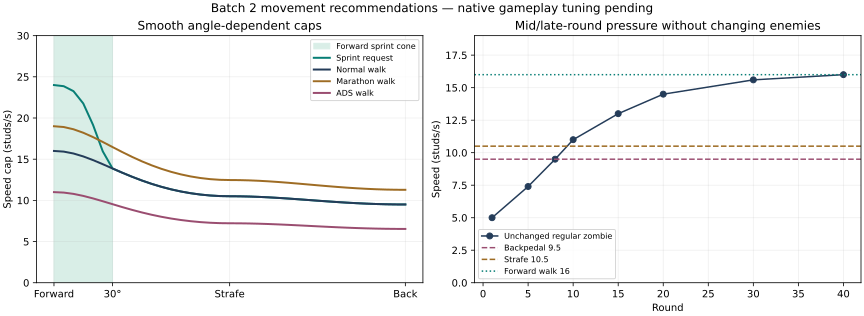

# Batch 2 — tactical movement (B2-01 / B2-06)

Scope: [Issue #62](https://github.com/stephennip9288-create/Roblox-Projects/issues/62). Branch `feature/dead-signal-batch2-movement`, starting from verified main/production checkpoint `7aaf323de6153134df2154c7ae3b1613a596495b`. No open PR or Batch 2 branch existed at the initial audit. Target is the subsequently established `integration/dead-signal-batch2`; MAIN owns review/merges and the combined candidate. Batch 1 remains accepted; Batch 3 is excluded.

## Recommended initial speeds

| State | Forward walk | Backpedal | Strafe | Forward sprint |
| --- | ---: | ---: | ---: | ---: |
| Normal | 16 | 9.50 | 10.50 | 24 |
| Marathon | 19 | 11.28125 | 12.46875 | 28 |
| ADS, including Marathon | 11 | 6.53125 | 7.21875 | Disabled |

Units are studs/second at full input. These are the final **source recommendations for initial playtesting**, not gameplay-accepted balance. Keep the owner's 16/24 starting values and Marathon 19/28; scale lateral and reverse walking by 10.5/16 and 9.5/16 respectively. Existing ADS takes precedence at 11. Marathon still has its existing 200 maximum stamina, versus normal 100. Weapon `weight` is used for the mystery-box probability in this source, not a movement penalty; no new weight penalty is invented.

The unchanged standard zombie curve reaches 5 at round 1, 7.4 at round 5, 9.5 at round 8, 11 at round 10, 13 at round 15 and 14.5 at round 20. Base backpedaling becomes unsafe around round 8 and strafing around round 10; Marathon extends that window to roughly rounds 11/14. Forward walking remains useful, and sprint is the committed escape option. ADS limits already create pressure earlier. Runners/hounds/modifiers remain faster threats; no enemy speed, damage, spawning or melee rules change here. Actual corner escape, crowding, hit fairness and round pacing must be played before locking values.

`Balance-Report.json` comes from the delivered Movement/Rules methods. Run `lune run Tools/review-movement-batch2.luau`, then `python Tools/render-movement-batch2.py` (Matplotlib required). The chart is a source calculation, not gameplay evidence.

## Policy and input

- Walking uses an elliptical polar speed cap: `1/sqrt((forward/longitudinalCap)^2+(side/strafeCap)^2)`, with unit horizontal direction. Diagonal axes are never added into a free boost; a forward 45° chord walks at about 12.415 normally. Analog magnitude remains with Humanoid:Move; the speed cap is not multiplied by it a second time.
- Sprint requires a fresh valid input, live combat participation, stamina, no blocked input/ADS/reload/travel, sufficient stick power and a direction strictly inside a 30° forward cone. W+A/W+D at 45°, pure side and reverse cannot sprint. The bonus smoothly tapers to walking at the cone edge.
- Increases accelerate at 40 studs/s² (normal walk to sprint in about .2s). Reductions clamp immediately to the new cap, including an abrupt reversal or invalid state. Normal turns have a continuous angle curve; smoothing may never retain an illegal sprint speed after a restriction.
- Keyboard Shift is hold-to-request: it may reengage when returning forward; release/Cancel clears it. Controller L3 is a toggle and invalid direction, stopping, stamina or state clears the toggle until a new press. Mobile keeps the existing outer-stick gesture and firing exclusions, with the same shared directional gate. Menus/focus/prompt/reload/ADS/down/respawn/travel cancel the appropriate requests.
- Stamina drain/recovery stay 18/24 per second. New starts require 12 stamina, ongoing sprint stops at 1; this avoids exhausted sprint/walk oscillation (roughly half a second to regain a fresh start). Client prediction reconciles authoritative exhaustion and state denials.
- Active first-person characters face horizontal camera direction consistently for keyboard, gamepad and the existing mobile camera. Noncombat/default orientation is restored; downed pose ownership stays intact. Steep pitch uses a stable horizontal fallback.

## Server authority and compatibility

The old Game tick read Humanoid.MoveDirection on the server, although that input property is not replicated, and granted a renewable per-tick teleport allowance. The new Game methods consume validated intent and observed displacement. Engine physics remains client-simulated with server validation; this does not claim adoption of Roblox's separate server-authority engine model or proof that arbitrary client physics is trustworthy.

| Existing interface | Additive change / ownership |
| --- | --- |
| `Look {pitch,yaw}` | Optional `move` horizontal finite Vector3, magnitude <=1.05 (normalized if just over 1), plus optional restrictive `blocked` boolean. Preserve pitch/yaw behavior, 12/s limiter/burst16 and eight-field boundary guard. |
| `Sprint {enabled}` | Same optional movement context; stores a request. Game grants actual `p.sprinting`; false clears it immediately for existing Fire behavior. No client speed/perk/stamina/dt is trusted. |
| State snapshot | Optional `movement={sprinting,speed,reason}`. Existing fields/callers still work. No new remote or profile setting. |
| Game movement | COMBAT/UI owns movement/stamina/tick/spawn/revive resets only. Enemy routing, extraction, rewards, arrivals, economy and combat rules are retained. |
| Controller | COMBAT/UI owns start/reset/input/render changes. `Controller.audioBindings` and Results/audio dispatch sections stay byte-identical to baseline for AUDIO's separate B2 work. |
| Tests/run.py | Only append `movement-batch2` to the existing 39 suites. MAIN must combine every lane's registration additively. |

Server policy uses replicated root facing and the stricter cap from intended and actually observed horizontal motion. The official client aligns its root with the camera. A private modified client's true camera cannot be observed/attested by the server; no such claim is made. Stale/missing movement context after .6s denies sprint and uses a conservative walking cap. Invalid vectors cannot refresh the intent clock; existing travel/life/rate restrictions remain.

The movement-debt validator accumulates **excess** horizontal distance across samples. Base burst tolerance is four studs; only server-measured GetNetworkPing can add up to .3s × 28 = 8.4 studs, once-per-second sampled. This bounded packet tolerance is not a new allowance per packet. Corrections retain debt, zero velocity and return to a prior accepted position; repeated tiny hops cannot reset credit. Supported safe-position history is restored on correction. Vertical falls/stairs do not count as horizontal speed; authorized spawn/revive reset sampling, and existing boundary rescue rebases the position while retaining debt. Damage invulnerability does not grant a movement bypass.

Roblox references: [Humanoid input/speed behavior](https://create.roblox.com/docs/reference/engine/classes/Humanoid), [network ownership and validation](https://create.roblox.com/docs/scripting/security/network-ownership). Native replication, latency/floor behavior and false positives still require engine testing. The test harness does not run real physics or network ownership.

## Lightweight feedback and accessibility

The existing vitals row now reads health plus `RUN`, `REST` or `READY` and stamina percentage, with the existing bar. There is no new HUD/control footprint or color-only cue. Down/revive text retains priority. The existing 270 HUD/layout scenarios remain registered.

Sprint camera motion is translation only, bounded by .008 horizontal/.010 vertical studs before settings scaling. It uses the existing Camera shake preference, including exact zero/off, and is disabled in Low Effects and ADS. It ends immediately with sprint. No roll, sprint FOV widening, sensitivity change or saved-control redesign is added. The current FOV/ADS/recoil/weapon behavior remains on its existing interfaces.

## Verification and remaining engine acceptance

See `Verification-Report.json` for the exact tested source commit, suite counts, runtime hashes, four-place lossless/fidelity results and preserved audio-binding hash. Focused checks execute actual Movement, Controller callbacks, Game, Network and UI methods: all-angle/rotated/analog caps, forward cone, holding/toggle/touch, camera turns, ADS/reload/state/stamina, bounded acceleration, invalid payloads/rate limits, two-player/perk isolation, persistent speed exploits, 50/150/300ms packet batches, vertical traversal and accessibility gates. These are deterministic service/clock/physics doubles, not device or multiplayer playtests.

**MAIN intake blocker:** the dev Python suite has 24 passes, two frozen-Batch-1 runtime-provenance failures and two PCM-fixture-dependent skips. `assert_reviewed_runtime` requires every current blob to equal the accepted Batch 1 ledger, so it rejects the intentional Game/Network/Movement/Controller/UI deltas. Historical ledgers, guards and workflows remain untouched. `PROPOSED-RUNTIME-DELTA.json` supplies exact immutable base/current hashes for MAIN's separately reviewed Batch 2 provenance path; it does not bless these changes itself. AUDIO #70 also needs its non-audio Controller guard reconciled centrally with this movement hunk. The PR stays draft/open for intake; no CI waiver or merge is requested.

- [ ] Desktop keyboard/mouse and controller: hold/toggle, stopping, reversals, 45° chords, quick yaw/vertical look, stairs/corners, shooting/melee/reload/swap/ADS, Marathon and stamina recovery.
- [ ] Android/iOS analog: partial/outer stick, transitions around the cone, firing layouts, prompts/menus/focus, readable vitals at small safe-area sizes, shake0/Low Effects and scoped ADS.
- [ ] All three maps at rounds1/5/10/15/20+, solo/two/four players, 40 enemies: chase pressure, escape paths, no melee unfairness, revive/down/respawn and Warden/extraction.
- [ ] Native replication at representative 50/150/300ms latency and jitter/loss; stationary-to-sprint, fast camera turns, landings/ramps, boundary rescue and server stalls. Record debt/correction counts and ensure no legitimate repeated rubber-banding before release. Simulate sustained speed/diagonal/stale-intent abuse separately.
- [ ] Check remote clients' character facing/animations and actual server speed/stamina agreement. Camera translation must be comfortable or disabled by preferences. Do not infer phone FPS or playability from offline caps.
- [ ] MAIN resolves shared-file/test-runner intake with AUDIO/ENEMY, verifies the combined four-place candidate and obtains separate staging approval. No specialist merge, staging publish or production publish is authorized.

Recovery is a source-only revert of this specialist change followed by the existing reviewed lossless build, with no profile migration/native asset rollback. Protected release/rollback binaries, manifests, place IDs, workflows and DataStore namespace are unchanged. Batch 3 is not included.
